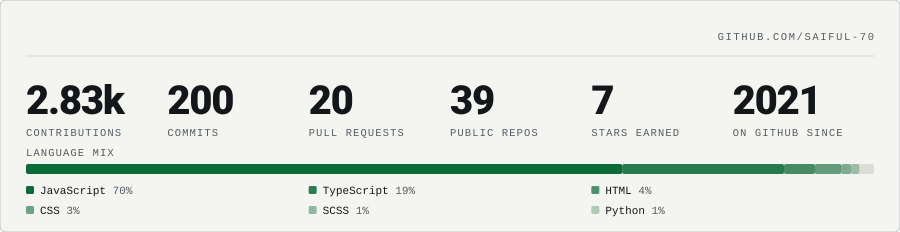

# Saiful Islam

Software engineer in **Dhaka, Bangladesh** (UTC+6), working remote. I turn how a business
actually runs into software that ships: **backend, web, mobile, deploy**, and the alerts that
watch it.

Spec first. AI agents write most of the code. I own what gets built, what gets cut, and the
gate it has to pass.

---

### How I build

| Step | Example |
| --- | --- |
| Find out how the business really runs | A property ERP billed as if the org were the landlord. It isn't; it sells a service to flat owners. |
| Change the model, not the screen | Rebuilt money into three tracks that never mix: rent, service charge, org accounts. |
| Decide what not to build | Dropped a planned mobile API service; the app calls the existing APIs through the gateway. |
| Ship every surface myself | Offline document app for field workers: sign-in, outbox, background sync, 405 tests, three weeks. |
| Put a gate behind it | The SaaS refuses to boot if any tenant table is missing a row-level security policy. |

### Products

| Product | For | The call | Status |
| --- | --- | --- | --- |
| **Certain QMS** (Netpower) | Quality managers, HSE staff and field workers at industrial companies | Treated a dead "evaluate this measure" link as a migration blocker; shipped evaluation, an offline Handbook app and one sign-in for all apps | in production |
| **[CampusQ](https://campusqbd.com)** | Coaching centres in Bangladesh running on paper and a personal mobile-money number | Built for the niche: Bangla first, guardian SMS without accounts, printed receipts; isolation checked at boot | live, pre-revenue |
| **Rent-ERP** | An organisation managing residential buildings for flat owners | The org is not the landlord: rent, service charge and org accounts never mix | in production, private |
| **Footwear ERP** (MultiTech) | Merchandisers and stores staff at a footwear factory | Re-platformed a garment ERP instead of starting over; QR document capture, Excel order intake | in production |
| **Institute payments** (freelance, 2025-06 →) | Two coaching institutes confirming fees by hand | One shared gateway with signed callbacks, no shared database | in production, private |
| **Family Connect App** | Families keeping health records offline, each person with their own login | Health data sensitive by default: encrypted phone database, export and hard delete | in acceptance |
| **[DebuggerMind Commerce](https://pogiecom.pogiit.com)** | Shoppers on low-end Android paying cash on delivery | One storefront codebase for many merchants; onboarding is one file, no fork | live |

### Things I removed

- Payment gateway integration in CampusQ. Manual transfer plus an operator check was enough for the first customers.
- Eight AI features in CampusQ, removed in eight slices with no migration.
- A separate mobile API service at Netpower. The existing module APIs, through the gateway, did the job.
- PDF input in the AI register importer. Spreadsheets only, so there is no OCR path to maintain.
- The multi-tenant layer in Rent-ERP. One organisation: no row-level security, no subdomains.
- Persona switching in Rent-ERP, in favour of plain roles.
- Fabricated stats and testimonials on the CampusQ marketing site, with a production cleanup script.

### Open source

**[Optimus UI](https://github.com/openng-org/optimus-ui)**: one merged fix. Row grouping crashed
with an empty sort array; regression tests included. It is the component layer under CampusQ, so
the fix runs where I can see it.

**[ngx-primeng-toolkit](https://www.npmjs.com/package/ngx-primeng-toolkit)**: table and
query-state helpers extracted from ERP work, published to npm with CI.

---

### Stack

**Frontend**

**Backend & data**

**Testing**

**DevOps & infra**

**Observability**

**AI & dev tools**

---

### At a glance

<picture>
  <source media="(prefers-color-scheme: dark)" srcset="assets/stats-dark.svg">
  
</picture>

Rendered from the GitHub API into a committed SVG and refreshed weekly by
<a href=".github/workflows/profile-stats.yml">a workflow</a> — no card service to go down.

---

### Elsewhere

| Platform | Handle | Profile |
| --- | --- | --- |
| LeetCode | `saiful70` | [leetcode.com/saiful70](https://leetcode.com/saiful70/) |
| Codewars | `saiful70` | [codewars.com/users/saiful70](https://www.codewars.com/users/saiful70) |
| Codeforces | `KhaWareZmI` | [codeforces.com/profile/KhaWareZmI](https://codeforces.com/profile/KhaWareZmI) |

Dhaka, BD · UTC+6 · <a href="https://saiful-70.github.io/saiful-70/">saiful-70.github.io/saiful-70</a>
